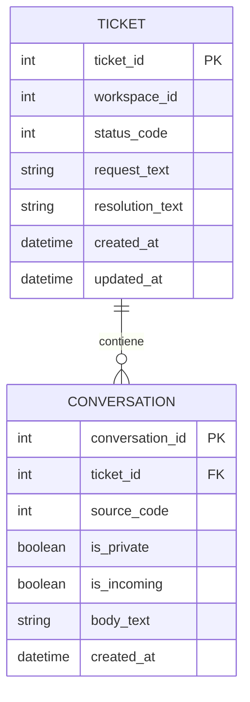

# Modelo de datos propuesto: Helpdesk DP-900

**Versión:** 1.0
**Origen:** Freshservice API v2
**Propósito:** conservar la solicitud, la respuesta enviada y las notas del ticket como datos separados para preparar una base de conocimiento.

## Hallazgo validado

`ticket.description_text` contiene la solicitud original del cliente. La respuesta y las notas viven en registros separados de `GET /api/v2/tickets/{id}/conversations`. Cada registro usa `body_text` para su texto; los metadatos `source`, `private` e `incoming` permiten interpretar el tipo y la visibilidad. `ticket.resolution_notes` y `ticket.resolution_notes_html` son campos distintos para la resolución registrada en el ticket.

En el ticket 31839 se observaron, sin mostrar sus textos:

- `resolution_notes` vacío.
- Una conversación `source=0`, `private=false`, `incoming=false`: correo público saliente, consistente con la respuesta al cliente.
- Una conversación `source=2`, `private=true`: nota privada interna.

La API define `source=0` como correo y `source=2` como nota. Freshservice también distingue una respuesta enviada al solicitante de una nota pública o privada. Véase la [API de Freshservice](https://api.freshservice.com/) y su artículo sobre la [diferencia entre notas y respuestas](https://support.freshservice.com/support/solutions/articles/50000000488-what-is-the-difference-between-a-note-and-a-reply-).

## Relaciones



## Entidad `Ticket`

| Campo canónico | Campo Freshservice | Uso |
|---|---|---|
| `ticket_id` | `id` | Clave primaria del ticket. |
| `workspace_id` | `workspace_id` | Conserva el espacio de trabajo de origen. |
| `status_code` | `status` | Estado original. |
| `status_label` | Derivado de `status` | 2=Open, 3=Pending, 4=Resolved, 5=Closed. |
| `ticket_type` | `type` | Tipo de ticket, por ejemplo Incident o Service Request. |
| `category` | `category` | Clasificación, si existe. |
| `sub_category` | `sub_category` | Subclasificación, si existe. |
| `item_category` | `item_category` | Categoría del elemento, si existe. |
| `request_text` | `description_text` | Necesidad o problema descrito por el cliente; no es la respuesta. |
| `resolution_text` | `resolution_notes` | Resolución registrada en el campo específico de Freshservice. |
| `created_at` | `created_at` | Fecha de creación del ticket. |
| `updated_at` | `updated_at` | Marca para detectar cambios entre extracciones. |
| `extracted_at` | Generado por el pipeline | Momento de lectura desde la API. |

## Entidad `Conversation`

Una fila por cada elemento de `conversations[]`. La clave primaria es el `id` de la conversación; `ticket_id` es la clave foránea.

| Campo canónico | Campo Freshservice | Uso |
|---|---|---|
| `conversation_id` | `id` | Clave primaria de la conversación. |
| `ticket_id` | `ticket_id` | Relación con el ticket. |
| `body_text` | `body_text` | Texto plano de una respuesta o una nota. El texto solo no determina el tipo. |
| `source_code` | `source` | Código de origen del registro. |
| `source_label` | Derivado de `source` | 0=email, 1=form, 2=note, 3=status, 4=meta, 5=feedback, 6=forward_email. |
| `is_private` | `private` | Distingue notas privadas de públicas; conservar nulo si la API no envía el campo. |
| `is_incoming` | `incoming` | Indica si el evento se originó fuera del portal. |
| `created_at` | `created_at` | Orden cronológico de las interacciones. |
| `updated_at` | `updated_at` | Cambios posteriores en la conversación. |

### Clasificación de conversaciones

- `source=2` y `private=true`: nota privada interna.
- `source=2` y `private=false`: nota pública.
- `source=0`, `incoming=false` y no privada: correo saliente; candidato a respuesta del agente al cliente.
- `incoming=true`: mensaje originado fuera del portal; no clasificar como respuesta del agente.
- Otros códigos: conservar como eventos de conversación, pero no tratarlos automáticamente como respuesta.

## Documento para búsqueda del agente

La estructura normalizada conserva todas las conversaciones. Para búsqueda semántica, se prepara un documento por ticket con estos campos:

```json
{
  "document_id": "freshservice:<workspace_id>:<ticket_id>",
  "ticket_id": 31839,
  "question_text": "<request_text depurado>",
  "resolution_text": null,
  "customer_response_text": "<body_text del correo saliente>",
  "internal_notes": ["<body_text de notas privadas depurado>"],
  "category": "<category>",
  "answer_source": "outgoing_reply",
  "curation_status": "needs_review"
}
```

Reglas de selección de respuesta y estado de curación:

1. Si `resolution_text` tiene contenido, usarlo como candidato principal y marcar `answer_source=resolution_notes`.
2. Si está vacío, guardar la respuesta pública saliente en `customer_response_text` y marcar `answer_source=outgoing_reply`; es candidata, porque una respuesta puede no describir la solución final.
3. Mantener las notas privadas en `internal_notes`, sin mezclarlas con la respuesta al cliente.
4. Si no hay resolución ni respuesta saliente, dejar ambos textos vacíos y marcar `curation_status=missing`.
5. No convertir automáticamente una nota privada en respuesta al cliente.
6. Marcar como `curation_status=approved` solo después de depurar datos personales y revisar que el texto sí representa una solución reutilizable; hasta entonces usar `needs_review`.

## Privacidad y límites

- No conservar en el modelo curado nombres, correos, teléfonos, IDs de requester/responder, destinatarios, CC ni URLs de adjuntos.
- `request_text`, `body_text` y `resolution_text` son texto libre y pueden contener datos personales. Deben pasar por depuración antes de crear documentos para el agente.
- Mantener `is_private` hasta la capa de acceso. Las notas privadas son solo contexto interno; nunca se presentan como respuesta pública.
- La extracción de inspección actual en `data/inspection/` contiene texto sin depurar. Es un artefacto local de desarrollo, no la base de conocimiento final.
- La carga semanal debe hacer upsert por `ticket_id` y `conversation_id`, usando `updated_at` para refrescar registros modificados.

## Alcance de la propuesta

Este es el modelo lógico y el contrato de campos de la fase de datos. La selección del servicio de almacenamiento en Azure y la política final para hacer consultables las notas privadas se definen en sus fases correspondientes.
